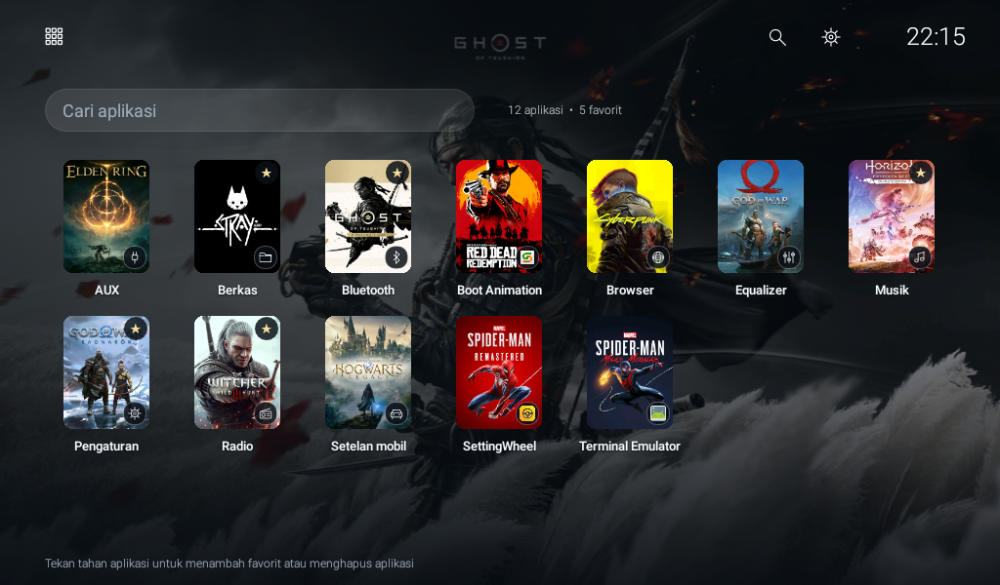
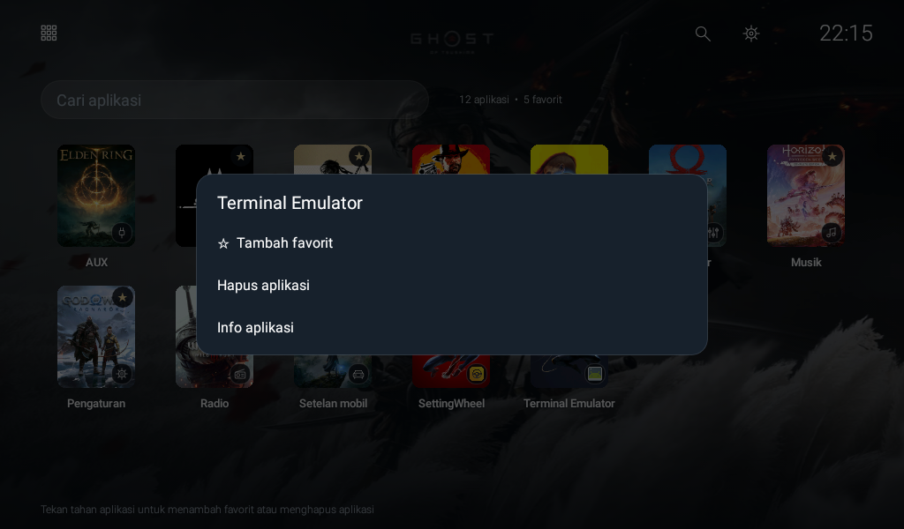

# DriveLite Headunit

[](https://github.com/adit7494/drivelite-headunit/actions/workflows/build.yml)
[](LICENSE)

Launcher Android native yang ringan untuk head unit mobil, dengan tampilan terinspirasi navigasi konsol: kartu favorit, wallpaper crossfade, jam, dan informasi kecepatan GPS.

**[Mulai dengan AI: setup dan debloat](docs/DEBLOAT.md) · [Unduh APK demo](https://github.com/adit7494/drivelite-headunit/releases/latest) · [Panduan pemasangan](docs/INSTALL.md) · [Build sendiri](docs/BUILD.md) · [Pemulihan](docs/RECOVERY.md)**

## Cara termudah: minta AI menyiapkan proyek

1. Buka AI yang bisa membaca folder dan menjalankan terminal di PC Windows.
2. Ikuti [5 langkah setup dengan AI](docs/DEBLOAT.md): kode Developer options/USB debugging TS7, sambungan Wi-Fi, dan **prompt siap salin**.
3. AI menyiapkan ADB, membaca aplikasi, lalu memberi rekomendasi beserta dampaknya. **Anda memilih paket dan tindakan sebelum AI mengubahnya.** Pemasangan DriveLite juga dapat dibantu AI.


> Screenshot menunjukkan instalasi pribadi dengan artwork game opsional. APK publik memakai 25 cover/wallpaper geometris buatan proyek. Gambar game tidak disertakan dalam repository atau APK demo; sumber dan cara mengunduhnya secara lokal tersedia di [panduan build](docs/BUILD.md#artwork-game-opsional).

## Yang tersedia

- Beranda berisi aplikasi favorit, tersimpan setelah launcher dibuka ulang.
- 25 slot cover berbeda dan wallpaper pasangannya; pembagian per aplikasi tetap konsisten.
- Ikon kotak untuk berpindah beranda/semua aplikasi; navigasi kiri, kanan, dan Enter di bawah.
- Tekan tahan untuk tambah/hapus favorit, info aplikasi, dan konfirmasi uninstall aplikasi pengguna.
- Jam 24 jam, pencarian, dan pengaturan di kanan atas.
- GPS kanan bawah dengan indikator hijau/merah; drift 1–2 km/h ditampilkan sebagai 0.
- Java Android native, tanpa WebView, iklan, service latar, atau izin internet. GPS aktif hanya saat beranda terlihat.

## Mulai dari sini

| Tujuan | Panduan |
| --- | --- |
| Memasang APK lewat flashdisk atau ADB Wi-Fi | [INSTALL.md](docs/INSTALL.md) |
| Setup/debloat dengan AI, kode TS7, dan prompt siap salin | [DEBLOAT.md](docs/DEBLOAT.md) |
| Referensi perintah ADB dan pemulihan debloat | [DEBLOAT-MANUAL.md](docs/DEBLOAT-MANUAL.md) |
| Melihat perubahan dan snapshot memori TS7 pengembang | [DEBLOAT-TS7.md](docs/DEBLOAT-TS7.md) |
| Mengatur favorit, wallpaper, dan memahami GPS | [USAGE.md](docs/USAGE.md) |
| Build demo atau artwork game opsional | [BUILD.md](docs/BUILD.md) |
| Kembali ke launcher bawaan | [RECOVERY.md](docs/RECOVERY.md) |
| Mengatasi ADB, GPS, atau signature mismatch | [TROUBLESHOOTING.md](docs/TROUBLESHOOTING.md) |
| Menyiapkan rilis berikutnya | [MAINTAINING.md](docs/MAINTAINING.md) |

## Screenshot

### Semua aplikasi



### Menu tekan tahan



## Quick start untuk build

Windows x64, PowerShell, dan internet diperlukan untuk setup awal. Tidak perlu Android Studio atau Gradle.

```powershell
git clone https://github.com/adit7494/drivelite-headunit.git
cd drivelite-headunit
.\setup.ps1
.\build.ps1 -Artwork Demo
.\test.ps1
```

APK dan checksum ada di `output/`. Untuk tampilan game pada screenshot:

```powershell
.\download-assets.ps1
.\build.ps1 -Artwork Original
```

Baca [NOTICE.md](NOTICE.md) untuk batas lisensi artwork. Build menggunakan keystore lokal yang tidak ikut Git. Pertahankan keystore yang sama agar APK dapat diperbarui.

## Perangkat yang diuji

| Bagian | Hasil |
| --- | --- |
| Platform | TS7 / `sp7731e_1h10_native` |
| Android sebenarnya | 8.1.0, API 27 |
| CPU/ABI | ARMv7 / `armeabi-v7a` |
| Layar | 1024 × 600 landscape |
| Versi aplikasi | 2.2, versionCode 4 |

Manifest mengizinkan API 21+, tetapi pengujian fisik dilakukan pada perangkat di atas. Uji pratinjau sebelum mengganti HOME default pada ROM lain. GPS berasal dari Android, bukan CAN/ECU atau status mesin. Boot/sleep-wake, kamera mundur, radio, dan tombol setir perlu diuji pada kendaraan masing-masing.

Installer tidak menghapus launcher OEM, tidak melakukan debloat otomatis, dan tidak memodifikasi MCU/firmware. [Catat HOME lama sebelum menggantinya](docs/RECOVERY.md). Debloat melalui ADB dibahas dalam [panduan terpisah](docs/DEBLOAT.md), termasuk dampak tiap aplikasi, pencatatan status awal, dan pemulihan.

## Pengujian dan kontribusi

GitHub Actions membangun APK demo, memverifikasi tanda tangan serta zip alignment, menjalankan 14 pemeriksaan pembagian cover/filter GPS, dan menguji collector inventaris dengan ADB simulasi. Tes collector mencakup perangkat belum diotorisasi, kegagalan inventaris, serta pembacaan tambahan yang tidak didukung. Pengujian UI pada head unit dicatat terpisah dan tidak dijalankan oleh CI.

Perbaikan dan laporan perangkat lain diterima melalui issue/PR. Ikuti [CONTRIBUTING.md](CONTRIBUTING.md), dan hapus data pribadi dari log atau screenshot sebelum mengunggahnya.

## Lisensi

Kode, teks dokumentasi, dan artwork demo: [MIT](LICENSE). Artwork game tetap milik penerbit; tidak termasuk lisensi proyek. DriveLite merupakan proyek independen dan tidak berafiliasi dengan Sony/PlayStation.
