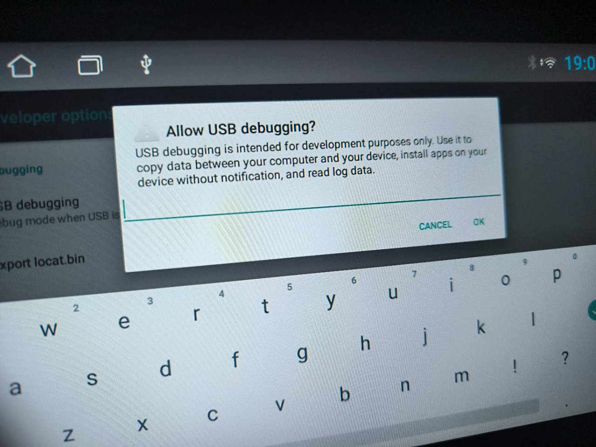

# Setup dan debloat dibantu AI

[Kembali ke README](../README.md) · [Referensi perintah](DEBLOAT-MANUAL.md) · [Hasil pada TS7](DEBLOAT-TS7.md)

**Anda mengatur head unit dan memilih aplikasinya; AI menyiapkan alat di PC, memeriksa perangkat, dan mengerjakan pilihan Anda.** Gunakan AI yang bisa membaca folder serta menjalankan terminal di PC Windows. Chat biasa tanpa akses PC hanya bisa memberi petunjuk.

## 1. Buka AI di PC

Buat/buka folder kerja kosong di aplikasi AI Anda. Salin prompt pada langkah 4; AI akan mengunduh proyek dan menyiapkan ADB. Jika proyek sudah ada, buka folder proyek tersebut agar AI membaca [AGENTS.md](../AGENTS.md).

## 2. Aktifkan debugging pada head unit

Hubungkan PC dan head unit ke Wi-Fi pribadi yang sama. Pada head unit, buka pengaturan Android → About/Build number; jika perlu, ketuk Build number tujuh kali untuk membuka Developer options. Letak menu berbeda menurut firmware.

Untuk **TS7/firmware sejenis unit pengembang**, kode yang digunakan dalam alur sesi proyek ini:

| Menu yang meminta kode | Isi |
| --- | --- |
| Developer options | `7890HH` — `HH` adalah jam pada **layar head unit**, format 24 jam, dua digit, tanpa menit |
| Saat menyalakan USB debugging | `john@tw-desktop` — huruf kecil, tanpa spasi |

Contoh: layar menunjukkan **18:45 → `789018`**, **07:30 → `789007`**. Ini kode khusus keluarga firmware TS7, bukan password universal. Jika ditolak, periksa jam pada head unit; jika tetap ditolak, minta kode sesuai firmware kepada penjual. Jangan gunakan menu factory reset/CAN untuk mencari kode.

<details>
<summary>Contoh dialog password USB debugging pada TS7</summary>



Masukkan `john@tw-desktop` pada dialog ini. Permintaan otorisasi PC yang menampilkan fingerprint RSA berbeda: periksa PC yang disambungkan, lalu pilih Allow.

</details>

Kode TS7 dilaporkan langsung oleh [pemilik TS7 di 4PDA](https://4pda.to/forum/index.php?showtopic=1028320&st=2480); cara Wi-Fi juga dibahas [pada thread perangkat yang sama](https://4pda.to/forum/index.php?showtopic=1028320&st=500). Dukungan tergantung firmware. Alur umum developer options dijelaskan dalam [dokumentasi Android](https://developer.android.com/studio/debug/dev-options).

## 3. Buka akses Wi-Fi dan catat IP

Pada TS7 lama yang mendukung cara ini, minta AI menyiapkan APK [Terminal Emulator dari pengembangnya](https://jackpal.github.io/Android-Terminal-Emulator/). Salin APK ke flashdisk, pasang pada head unit, lalu buka Terminal **di head unit** dan ketik:

```sh
setprop persist.wifi.debug 1
```

Lihat alamat IP pada detail Wi-Fi head unit dan berikan ke AI. Setujui dialog Allow dari PC Anda bila muncul. Ini langkah fisik yang perlu Anda lakukan; perintah PC berikutnya dikerjakan AI. Jika `setprop` gagal atau head unit menyediakan Wireless debugging/pairing, kirim pesan/port yang tampil ke AI agar memakai [metode koneksi yang sesuai](INSTALL.md#sambungkan-head-unit).

## 4. Salin prompt ini ke AI

Ganti bagian `[ISI ...]`. Prompt boleh diberikan sejak langkah 1; AI menyiapkan PC sambil Anda mengatur head unit.

```text
Bantu setup proyek https://github.com/adit7494/drivelite-headunit di PC Windows
ini untuk audit dan debloat head unit. Kerjakan perintah PC untuk saya.

IP/serial head unit: [ISI IP, misalnya 192.168.1.50:5555; jika belum tahu, tanyakan]
Fitur yang saya gunakan: [ISI, misalnya radio, Bluetooth, kamera mundur, Maps]
Fitur yang tidak saya gunakan: [ISI, misalnya Assistant, backup Google, cuaca]
Launcher DriveLite: [ISI ingin dipasang / tidak perlu / nanti]

1. Clone/unduh repo ke folder kerja ini jika belum ada. Baca AGENTS.md dan
   docs/DEBLOAT.md. Siapkan ADB dengan setup.ps1 -AdbOnly. Jangan meminta saya
   memasang SDK atau mengetik perintah PC satu per satu.
2. Pandu hanya langkah fisik yang diperlukan: kode menu TS7 sesuai panduan,
   Terminal pada head unit bila perlu, IP, dan Allow debugging. Jika butuh
   Terminal, unduh APK dari tautan pengembang di panduan ke output/ untuk
   saya salin ke flashdisk. Jangan menyebarkan APK audit atau memakai sumber acak.
3. Sambungkan satu serial yang saya berikan; pastikan status device. Jalankan
   scripts/Inspect-Headunit.ps1 -Serial SERIAL -Connect. Baca inventory.json,
   packages.txt, memory.txt, processes.txt, home.txt, webview.txt, capture-status.json.
   Periksa Android/user yang sebenarnya serta pembacaan yang gagal.
4. Audit semua aplikasi dari data perangkat ini. Buat tabel bernomor berisi
   nama aplikasi/paket, fungsi/bukti, status awal, dampak, keyakinan, dan saran:
   pertahankan / kandidat nonaktifkan / perlu diperiksa. Label/fungsi yang
   belum terbukti harus ditandai. Jangan memakai daftar hapus otomatis atau
   menebak manfaat RAM. Sajikan kandidat utama, lalu inventaris lengkap.
5. Tanyakan pilihan saya dengan nomor atau nama paket. Sampai saya memilih,
   hanya baca data; jangan disable/uninstall, mengubah animasi, atau mengganti
   launcher. Paket aktif bukan otomatis bloatware. Pertahankan fungsi mobil,
   framework, provider WebView aktif, dan launcher OEM untuk pemulihan.
6. Setelah saya memilih paket DAN tindakan, simpan status awal, kerjakan satu
   per satu, verifikasi hasil, dan sediakan perintah pemulihan. Awali kandidat
   opsional dengan nonaktifkan; uninstall hanya bila saya memilihnya dan cara
   pemulihan sudah jelas. Jangan meminta konfirmasi yang sama berulang kali.
   Minta saya menguji radio/Bluetooth/kamera/tombol/GPS setelah perubahan.
7. Jika saya memilih DriveLite, bantu unduh APK demo atau build sesuai pilihan
   artwork, pasang sebagai pratinjau, uji, lalu tawarkan menjadikannya HOME.
   Simpan launcher OEM. Hasil audit/log tetap lokal di output/, tidak dipush
   ke GitHub. Akhiri dengan ringkasan dan cara mematikan debugging.
```

## 5. Pilih dari hasil audit AI

Contoh jawaban: **“Nonaktifkan nomor 2, 4, dan 7. Pertahankan Maps dan kontak.”** Untuk uninstall, sebutkan paket dan tindakan itu secara eksplisit. AI kemudian mengerjakan pilihan tersebut dan memberi cara pemulihan. Keputusan yang belum jelas tetap menunggu pilihan Anda.

APK DriveLite hanya launcher; inventaris tidak menghapus aplikasi. [Collector](../scripts/Inspect-Headunit.ps1) hanya membaca perangkat dan menyimpan hasil lokal. Detail tindakan/pemulihan ada di [referensi ADB](DEBLOAT-MANUAL.md#8-pemulihan).
