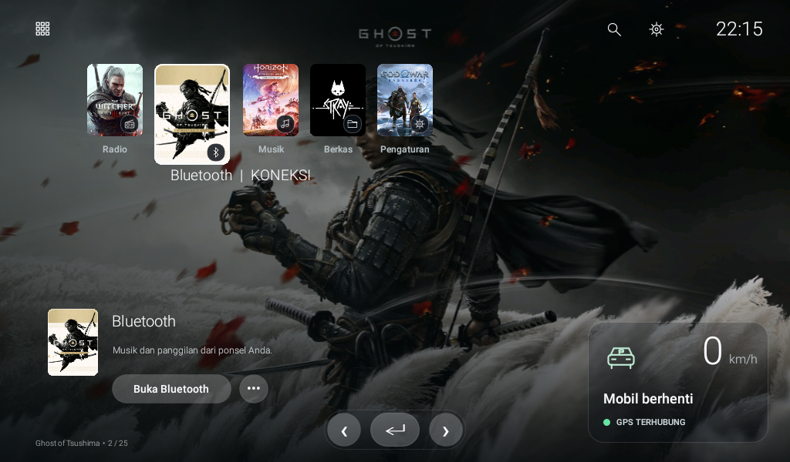

# Pasang DriveLite di head unit

[Kembali ke README](../README.md) · [Jika perlu kembali ke launcher lama](RECOVERY.md)

## 1. Periksa perangkat

DriveLite diuji pada TS7, Android **8.1/API 27**, ARMv7, layar **1024 × 600 landscape**. Minimum manifest API 21; ROM/perangkat lain belum diuji. Versi Android yang ditampilkan menu head unit kadang berbeda dari properti sistem.

Jika sudah memiliki ADB, periksa versi sebenarnya:

```powershell
adb shell getprop ro.build.version.release
adb shell getprop ro.build.version.sdk
adb shell wm size
```

Pemasangan ini tidak memerlukan root, perubahan MCU, atau penghapusan launcher bawaan.

## 2. Pilih APK

Unduh `DriveLite.apk` dan `SHA256SUMS.txt` dari [Releases](https://github.com/adit7494/drivelite-headunit/releases). APK publik memakai **artwork demo geometris**, sehingga dapat dibagikan bersama kode MIT. Untuk tampilan dengan cover game seperti screenshot, [build dengan artwork opsional](BUILD.md#artwork-game-opsional).

Di PowerShell, cocokkan hasil berikut dengan `SHA256SUMS.txt`:

```powershell
Get-FileHash .\DriveLite.apk -Algorithm SHA256
```

## 3A. Cara sederhana: lewat flashdisk

1. Salin APK ke flashdisk.
2. Sambungkan flashdisk ke head unit dan buka File Manager.
3. Buka APK, lalu izinkan pemasangan dari File Manager bila diminta Android.
4. Pasang DriveLite dan buka dari daftar aplikasi.
5. Izinkan lokasi agar kecepatan GPS dapat tampil. Jika belum ada sinyal, indikator akan merah dan angka `—`.
6. Uji ikon kotak, buka aplikasi, pengaturan, serta fungsi mobil yang biasa dipakai.
7. Setelah cocok, pilih DriveLite sebagai aplikasi Home default melalui pengaturan aplikasi default atau pemilih launcher yang muncul saat tombol Home ditekan.



Screenshot di atas memakai artwork game opsional. Posisi kontrol pada APK demo sama.

## 3B. Cara ADB: PC Windows

### Siapkan ADB

Unduh/clone proyek, buka PowerShell di foldernya, lalu:

```powershell
.\setup.ps1 -AdbOnly
$adb = '.\.tools\platform-tools\adb.exe'
& $adb version
```

Jika Windows memblokir skrip, gunakan sesi PowerShell ini saja:

```powershell
Set-ExecutionPolicy -Scope Process -ExecutionPolicy Bypass
```

### Sambungkan head unit

Hubungkan PC dan head unit ke Wi-Fi pribadi yang sama. Cari IP di detail jaringan head unit; **alamat di bawah hanya contoh**.

**Android 11 atau lebih baru, jika menu Wireless debugging tersedia:**

```powershell
& $adb pair 192.168.1.50:37001
# Masukkan pairing code dari layar head unit.
& $adb connect 192.168.1.50:40123
& $adb devices -l
```

Port pairing dan port koneksi berbeda; gunakan yang ditampilkan perangkat Anda.

**Android lama:** USB debugging tidak otomatis membuka ADB lewat Wi-Fi. Pada perangkat dengan port data/OTG yang mendukung ADB, sambungkan sesuai petunjuk pabrikan dan jalankan:

```powershell
& $adb devices -l
& $adb -s SERIAL_USB tcpip 5555
& $adb connect 192.168.1.50:5555
```

Pada TS7 yang dipakai pengembang, firmware juga menerima perintah ini di aplikasi Terminal **pada head unit**:

```sh
setprop persist.wifi.debug 1
```

Ini cara khusus firmware, bukan perintah universal Android. Jangan menjalankannya di PowerShell PC. Jika muncul `Permission denied`/gagal mengubah properti, pakai metode yang didukung perangkat tersebut. Password developer/debugging juga bergantung pada vendor; tanyakan penjual, bukan menebak kode universal.

Setujui **Allow USB debugging** pada head unit. Lanjutkan setelah `adb devices -l` menampilkan status `device`, bukan `unauthorized`.

### Pasang sebagai pratinjau

Dengan APK hasil build di `output/DriveLite.apk`:

```powershell
.\scripts\Install.ps1 -Serial '192.168.1.50:5555' -Connect -GrantLocation
```

Untuk APK yang diunduh dari Releases:

```powershell
.\scripts\Install.ps1 -Serial '192.168.1.50:5555' -Connect -ApkPath "$env:USERPROFILE\Downloads\DriveLite.apk" -GrantLocation
```

Skrip mencatat HOME lama ke `output/device-backups/` ketika dapat dikenali, memasang APK, dan membuka pratinjau. **HOME default belum diubah.** Folder backup diabaikan Git.

### Jadikan Home setelah pengujian

```powershell
.\scripts\Install.ps1 -Serial '192.168.1.50:5555' -SetAsHome
```

Atau langsung, setelah APK sudah terpasang:

```powershell
& $adb -s '192.168.1.50:5555' shell cmd package set-home-activity --user 0 id.adhit.drivelite/.MainActivity
& $adb -s '192.168.1.50:5555' shell input keyevent KEYCODE_HOME
```

Perintah HOME ini telah diuji pada ROM TS7 yang disebut di atas. Jika ROM lain tidak menyediakan perintahnya, gunakan menu aplikasi default Android. Tetap simpan launcher lama agar [pemulihan](RECOVERY.md) mudah.

## 4. Periksa hasil

- Ikon kotak kiri atas membuka/menutup daftar aplikasi.
- Tombol kiri/kanan memilih favorit, tombol Enter membuka pilihan.
- Roda gigi kanan atas membuka pengaturan.
- Tekan tahan aplikasi menampilkan menu favorit dan hapus.
- GPS hijau setelah fix valid; pembacaan 1–2 km/h ditampilkan sebagai 0.
- Uji radio, audio Bluetooth, kamera mundur, tombol setir, serta boot/sleep-wake langsung pada kendaraan. Paket vendor pendukung fungsi tersebut tidak diubah oleh installer ini.

Setelah selesai, matikan debugging yang tidak lagi diperlukan. Lihat [Troubleshooting](TROUBLESHOOTING.md) untuk kegagalan koneksi atau instalasi.

Referensi: [ADB resmi Android](https://developer.android.com/tools/adb), [Platform-Tools](https://developer.android.com/tools/releases/platform-tools).
